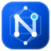

# OVH Nexus

<p align="center">
  
</p>

<p align="center">
  <strong>OVHcloud Control &amp; Procurement Console</strong><br/>
  Unified Cloud Fleet Management, Live Order &amp; Delivery Tracking, and Automated Bare-Metal / VPS Procurement.
</p>

<p align="center">
  <a href="./README.md"><strong>English</strong></a> ·
  <a href="./docs/README.fr.md">Français</a> ·
  <a href="./docs/README.zh-CN.md">简体中文</a>
</p>

<p align="center">
  <a href="https://ovh-nexus.ellery.me" target="_blank" rel="noopener noreferrer"></a>
  <a href="https://hub.docker.com/r/elleryhe/ovh-nexus" target="_blank" rel="noopener noreferrer"></a>
  <a href="./LICENSE"></a>
  
</p>

---

## Overview

**OVH Nexus** is a self-hosted, multi-account web console built for OVHcloud users (`ovh-eu`, `ovh-ca`, and `ovh-us`). It unifies **day-to-day cloud infrastructure operations** with **real-time datacenter stock monitoring, public SKU change tracking, and automated bare-metal/VPS procurement** in a single container.

- **Dedicated Server & VPS Fleet Control**: Hardware inventory, MRTG traffic telemetry, IPMI/KVM console, automated OS reinstallation with custom RAID/ZFS & SSH key injection, IP Edge Firewall & permanent Anti-DDoS mitigation, and VPS lifecycle control.
- **Orders, Delivery & Renewal Matrix**: Live 4-stage order delivery tracking (`CREATING` → `VALIDATING` → `DELIVERING` → `INSTALLATION`) and unified service expiration countdowns across all accounts.
- **Live Availability Matrix & Auto-Order Queue**: Real-time stock across global datacenters enriched with commercial model names (`KS-A`, `RISE-1`, `SCALE-a1`), readable hardware specs, and exact configuration-level monthly pricing.
- **Public SKU Watcher & Pluggable Notification Center**: Track newly racked or removed server SKUs without an API key, and dispatch alerts via multi-instance **Telegram Bots** and **SMTP Email** across 7 fine-grained events.

📚 **Full Documentation**: <a href="https://ovh-nexus.ellery.me" target="_blank" rel="noopener noreferrer"><strong>https://ovh-nexus.ellery.me</strong></a>

---

## Quick Start (Docker Compose)

OVH Nexus is distributed as an all-in-one multi-arch Docker image (`elleryhe/ovh-nexus:latest`) bundling the React frontend (served by Nginx) and the Python backend. No Git clone is required to deploy.

### 1. Create a Working Directory & `.env`

```bash
mkdir -p ovh-nexus && cd ovh-nexus

cat > .env << EOF
# Required: Console login password / API secret key (at least 12 characters)
API_SECRET_KEY=$(openssl rand -hex 24)

# Optional: Default WebUI locale (en | fr | zh-CN)
DEFAULT_LOCALE=en

# Optional: Set to true when serving behind an HTTPS reverse proxy
COOKIE_SECURE=false
EOF
```

### 2. Create `docker-compose.yml`

```yaml
services:
  ovh-nexus:
    image: ${DOCKER_IMAGE:-elleryhe/ovh-nexus:latest}
    container_name: ovh-nexus
    ports:
      - "20000:80"
    environment:
      - DEBUG=false
      - ENABLE_API_KEY_AUTH=true
      - API_SECRET_KEY=${API_SECRET_KEY:?Please set a strong API_SECRET_KEY (at least 12 characters) in .env}
      - COOKIE_SECURE=${COOKIE_SECURE:-false}
      - DEFAULT_LOCALE=${DEFAULT_LOCALE:-en}
      - BIND_HOST=127.0.0.1
    volumes:
      - ./data:/app/backend/data
      - ./logs:/app/backend/logs
      - ./cache:/app/backend/cache
    restart: unless-stopped
```

### 3. Launch the Container

```bash
docker compose up -d
```

Open `http://localhost:20000` and sign in with the `API_SECRET_KEY` generated in your `.env` file (`grep API_SECRET_KEY .env`).

---

## Documentation Links

| Guide | Link |
| :--- | :--- |
| **Quick Start & Installation** | <a href="https://ovh-nexus.ellery.me/getting-started/quick-start/" target="_blank" rel="noopener noreferrer">ovh-nexus.ellery.me/getting-started/quick-start/</a> |
| **Reverse Proxy & HTTPS (`COOKIE_SECURE`)** | <a href="https://ovh-nexus.ellery.me/getting-started/reverse-proxy/" target="_blank" rel="noopener noreferrer">ovh-nexus.ellery.me/getting-started/reverse-proxy/</a> |
| **Environment Variables & OVH API Keys** | <a href="https://ovh-nexus.ellery.me/configuration/environment-variables/" target="_blank" rel="noopener noreferrer">ovh-nexus.ellery.me/configuration/environment-variables/</a> |
| **Feature Guides (Fleet, Stock, SKU Watcher, Notifications)** | <a href="https://ovh-nexus.ellery.me/features/dedicated-servers/" target="_blank" rel="noopener noreferrer">ovh-nexus.ellery.me/features/dedicated-servers/</a> |
| **Security Best Practices & Troubleshooting** | <a href="https://ovh-nexus.ellery.me/operations/security/" target="_blank" rel="noopener noreferrer">ovh-nexus.ellery.me/operations/security/</a> |

---

## License & Disclaimer

Licensed under the **GNU Affero General Public License v3.0 (AGPL-3.0)**. See [LICENSE](./LICENSE), [CONTRIBUTING.md](./CONTRIBUTING.md), and [SECURITY.md](./SECURITY.md).

> **OVH Nexus** is an independent open-source project and is **not affiliated with, endorsed by, or sponsored by OVH SAS / OVHcloud**. "OVH" and "OVHcloud" are registered trademarks of OVH SAS.
