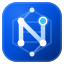

# OVH Nexus (Français)

<p align="center">
  
</p>

<p align="center">
  <strong>Console de Contrôle &amp; d’Approvisionnement OVHcloud</strong><br/>
  Gestion unifiée de flotte Cloud, suivi de livraison en direct et approvisionnement automatisé de serveurs dédiés et VPS.
</p>

<p align="center">
  <a href="../README.md">English</a> ·
  <a href="./README.fr.md"><strong>Français</strong></a> ·
  <a href="./README.zh-CN.md">简体中文</a>
</p>

<p align="center">
  <a href="https://ovh-nexus.ellery.me/fr/"></a>
  <a href="https://hub.docker.com/r/elleryhe/ovh-nexus"></a>
  
</p>

---

## Présentation

**OVH Nexus** est une console web auto-hébergée et multi-comptes conçue pour les utilisateurs d’OVHcloud (`ovh-eu`, `ovh-ca`, `ovh-us`). Elle réunit dans un seul conteneur Docker **la gestion quotidienne de votre infrastructure Cloud** et **la surveillance de stock, la veille SKU et la commande automatisée**.

- **Contrôle des Serveurs Dédiés & VPS** : Inventaire matériel, trafic MRTG, console IPMI/KVM, réinstallation OS automatisée (RAID/ZFS, injection de clés SSH), pare-feu IP Edge & mitigation Anti-DDoS, et gestion VPS.
- **Commandes, Livraison & Renouvellements** : Suivi en direct des 4 étapes de livraison (`CREATING` → `VALIDATING` → `DELIVERING` → `INSTALLATION`) et matrice d’expiration des services.
- **Disponibilité en Direct & File d’Achat Auto** : Stock en temps réel enrichi avec les noms commerciaux (`KS-A`, `RISE-1`, `SCALE-a1`), spécifications lisibles et tarification mensuelle exacte par configuration.
- **Veille SKU & Centre de Notifications** : Détection sans clé API des nouveaux modèles ou retraits de serveurs, et alertes multi-canaux (**Telegram Bot** et **Email SMTP**) sur 7 événements.

📚 **Documentation complète (Français)** : **[https://ovh-nexus.ellery.me/fr/](https://ovh-nexus.ellery.me/fr/)**

---

## Démarrage Rapide (30 secondes)

```bash
# 1. Créer le fichier de configuration .env
cp .env.example .env
# Éditez .env et définissez une clé API_SECRET_KEY robuste (au moins 12 caractères)

# 2. Démarrer avec Docker Compose
docker compose up -d
```

Accédez à `http://localhost:20000` et connectez-vous avec votre `API_SECRET_KEY`.

---

## Liens Utiles

| Guide | Lien |
| :--- | :--- |
| **Démarrage Rapide & Installation** | [ovh-nexus.ellery.me/fr/getting-started/quick-start/](https://ovh-nexus.ellery.me/fr/getting-started/quick-start/) |
| **Reverse Proxy & HTTPS (`COOKIE_SECURE`)** | [ovh-nexus.ellery.me/fr/getting-started/reverse-proxy/](https://ovh-nexus.ellery.me/fr/getting-started/reverse-proxy/) |
| **Variables d’Environnement & Clés API OVH** | [ovh-nexus.ellery.me/fr/configuration/environment-variables/](https://ovh-nexus.ellery.me/fr/configuration/environment-variables/) |
| **Guides des Fonctionnalités** | [ovh-nexus.ellery.me/fr/features/dedicated-servers/](https://ovh-nexus.ellery.me/fr/features/dedicated-servers/) |
| **Sécurité & Dépannage** | [ovh-nexus.ellery.me/fr/operations/security/](https://ovh-nexus.ellery.me/fr/operations/security/) |

---

## Licence & Clause de non-responsabilité

Distribué sous licence **GNU Affero General Public License v3.0 (AGPL-3.0)**. Voir [LICENSE](../LICENSE), [CONTRIBUTING.md](../CONTRIBUTING.md) et [SECURITY.md](../SECURITY.md).

> **OVH Nexus** est un projet open-source indépendant et n’est **pas affilié à, ni approuvé par OVH SAS / OVHcloud**. « OVH » et « OVHcloud » sont des marques déposées d’OVH SAS.
