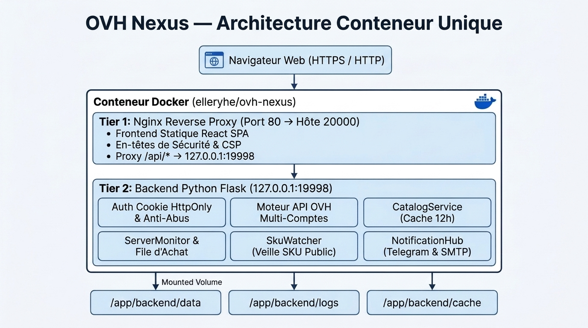

**OVH Nexus** est une console web auto-hébergée et multi-comptes conçue pour les utilisateurs et administrateurs d'infrastructures OVHcloud (`OVH Europe`, `OVH Canada / Asie-Pacifique` et `OVH US`). Elle réunit **la gestion quotidienne de votre flotte Cloud** et **la surveillance de stock en temps réel, la veille publique des SKU et l'approvisionnement automatisé** au sein d'un seul conteneur Docker.

## Pourquoi OVH Nexus ?

Gérer plusieurs comptes OVHcloud sur différentes régions (`ovh-eu`, `ovh-ca`, `ovh-us`) ou acquérir des serveurs à forte demande (`Kimsufi`, `So you Start`, `Rise`, `Advance`, `Scale`) nécessite souvent de jongler entre des scripts isolés, des onglets de navigateur et l'API OVHcloud.

OVH Nexus unifie tout le cycle de vie dans une seule interface :

1. **Veille Publique Sans Clé API** : Consultez le stock par datacenter, les prix mensuels exacts par configuration, les noms commerciaux (`KS-A`, `RISE-1`, `SCALE-a1`) et l'historique des changements SKU **sans configurer de clé API OVHcloud**.
2. **Approvisionnement Automatisé** : Placez vos configurations cibles en file d'attente ou surveillez un FQN précis afin de générer automatiquement la commande dès l'apparition du stock.
3. **Suivi des Commandes & Livraison** : Récupérez les liens de paiement et suivez les 4 étapes du pipeline de livraison (`CREATING` → `VALIDATING` → `DELIVERING` → `INSTALLATION`) en temps réel.
4. **Exploitation Quotidienne (Day-2)** : Pilotez vos serveurs dédiés et VPS achetés — réinstallation OS avec RAID/ZFS et clés SSH, console IPMI/KVM, pare-feu IP Edge, mitigation Anti-DDoS et matrice d'expiration des services.

## Architecture du Système

OVH Nexus est distribué sous forme d'un conteneur unique (`elleryhe/ovh-nexus`) :

## Régions OVHcloud Prises en Charge

| Code Région | Point de Terminaison API | Couverture |
| :--- | :--- | :--- |
| `ovh-eu` | `https://eu.api.ovh.com/1.0` | Europe, Afrique, Moyen-Orient (France, Allemagne, Royaume-Uni, Pologne, etc.) |
| `ovh-ca` | `https://ca.api.ovh.com/1.0` | Canada, Asie-Pacifique (`BHS`, Singapour `SGP`, Sydney `SYD`, Mumbai `MUM`) |
| `ovh-us` | `https://api.us.ovhcloud.com/1.0` | États-Unis (`VIN` Vint Hill, `HIL` Hillsboro) |

## Prochaines Étapes

- Suivez le [Démarrage Rapide en 30 secondes](/fr/getting-started/quick-start/) pour lancer votre instance avec Docker Compose.
- Configurez un accès HTTPS sécurisé dans [Reverse Proxy & HTTPS](/fr/getting-started/reverse-proxy/).
- Générez vos identifiants API dans [Clés API OVHcloud](/fr/configuration/ovh-api-credentials/).
