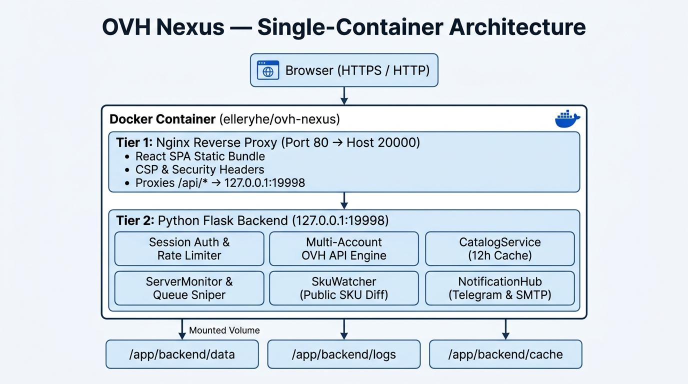

**OVH Nexus** is a self-hosted, multi-account web console built for OVHcloud infrastructure operators (`OVH Europe`, `OVH Canada / Asia-Pacific`, and `OVH US`). It combines **day-to-day cloud fleet administration** with **real-time datacenter stock monitoring, public SKU change tracking, and automated bare-metal/VPS procurement** inside a single Docker container.

## Why OVH Nexus?

Managing multiple OVHcloud accounts across regions (`ovh-eu`, `ovh-ca`, `ovh-us`) and catching high-demand Eco (`Kimsufi`, `So you Start`, `Rise`) or Baremetal (`Advance`, `Scale`, `High Grade`) servers often requires juggling separate scripts, browser tabs, and API tools.

OVH Nexus unifies the entire lifecycle in one web interface:

1. **Zero-Key Public Intelligence**: Browse live datacenter stock, configuration-level monthly pricing, commercial server names (`KS-A`, `RISE-1`, `SCALE-a1`), and public SKU shelf changes **without configuring an OVHcloud API key**.
2. **Automated Procurement**: Queue target server configurations (`planCode`, datacenter, memory, storage, addons) or subscribe to restock alerts so orders are placed automatically the moment inventory appears.
3. **Order & Delivery Visibility**: Once an order is generated, track payment status and watch the 4-stage physical provisioning pipeline (`CREATING` → `VALIDATING` → `DELIVERING` → `INSTALLATION`) directly in the console.
4. **Day-2 Infrastructure Control**: Manage your delivered Dedicated Servers and VPS instances—reinstall OS templates with custom RAID/ZFS and SSH keys, open IPMI/KVM consoles, configure IP Edge Firewall rules, and monitor service expiration dates.

## System Architecture

OVH Nexus is distributed as an all-in-one container (`elleryhe/ovh-nexus`):

## Supported OVHcloud Regions

| Region Code | API Endpoint | Coverage |
| :--- | :--- | :--- |
| `ovh-eu` | `https://eu.api.ovh.com/1.0` | Europe, Africa, Middle East (France, Germany, UK, Poland, etc.) |
| `ovh-ca` | `https://ca.api.ovh.com/1.0` | Canada, Asia-Pacific (Beauharnois, Singapore, Sydney, Mumbai) |
| `ovh-us` | `https://api.us.ovhcloud.com/1.0` | United States (`VIN` Vint Hill, `HIL` Hillsboro) |

## Next Steps

- Follow the [30-Second Quick Start](/getting-started/quick-start/) to launch your instance with Docker Compose.
- Learn how to expose OVH Nexus safely over HTTPS in [Reverse Proxy & HTTPS](/getting-started/reverse-proxy/).
- Generate your regional API keys in [OVHcloud API Credentials](/configuration/ovh-api-credentials/).
